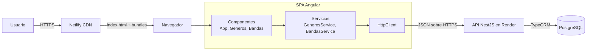
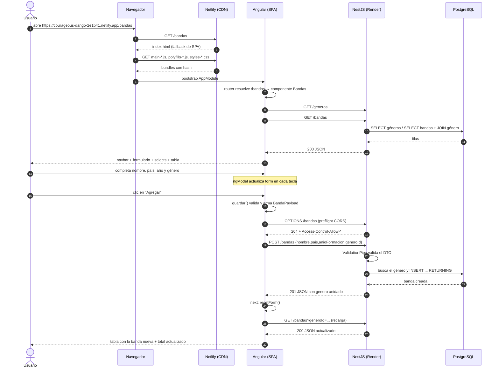

# Guía del frontend — TP Tecnologías Web

Esta guía explica **todo lo que hay en el frontend**: qué hace cada archivo, por qué se tomó cada
decisión y qué ocurre desde que un cliente entra a la página hasta que agrega una banda y ve la
tabla actualizada.

Está pensada para estudiar y para la defensa: al final hay un cuestionario y los links al
material de la cátedra y a la documentación oficial.

> **Resumen en 10 líneas.** Es una SPA en Angular 20 con NgModules. `index.html` solo tiene
> `<app-root>`; `main.ts` arranca `AppModule`, que declara `App`, `Generos` y `Bandas`. El router
> muestra `Bandas` en `/bandas` (la ruta por defecto). El componente inyecta dos servicios, que
> son los únicos que hablan con la API de Render usando `HttpClient`. Al entrar se piden
> `GET /generos` y `GET /bandas`; al enviar el formulario se hace `POST /bandas` y después se
> vuelve a pedir el listado. La relación 1 a N se ve en el `<select>` de género (se bindea por
> **id**) y en el badge `banda.genero.nombre`. Los errores del backend se muestran como alertas y
> la URL de la API sale de `environment`, nunca está escrita en los servicios.

---

## Índice

1. [Mapa general y arquitectura](#1-mapa-general-y-arquitectura)
2. [Decisiones y por qué](#2-decisiones-y-por-qué)
3. [Archivos y responsabilidades](#3-archivos-y-responsabilidades)
4. [El arranque de la SPA](#4-el-arranque-de-la-spa)
5. [El modelo de datos del front](#5-el-modelo-de-datos-del-front)
6. [Los servicios: la única puerta a la API](#6-los-servicios-la-única-puerta-a-la-api)
7. [Componente Géneros](#7-componente-géneros)
8. [Componente Bandas](#8-componente-bandas)
9. [Errores y validación](#9-errores-y-validación)
10. [Estilos y responsive](#10-estilos-y-responsive)
11. [Tests](#11-tests)
12. [Flujo completo: entrar y agregar una banda](#12-flujo-completo-entrar-y-agregar-una-banda)
13. [Build y deploy](#13-build-y-deploy)
14. [Problemas encontrados y cómo se resolvieron](#14-problemas-encontrados-y-cómo-se-resolvieron)
15. [Diferencias con el material de cátedra (Angular 12 → 20)](#15-diferencias-con-el-material-de-cátedra-angular-12--20)
16. [Preguntas de defensa](#16-preguntas-de-defensa)
17. [Para repasar](#17-para-repasar)
18. [Cómo evolucionó el frontend (commits)](#18-cómo-evolucionó-el-frontend-commits)

---

## 1. Mapa general y arquitectura

**Aplicación:** administración de **Bandas** y **Géneros musicales** (relación 1 a N) desde una
SPA. Consume la API NestJS de la Entrega 1.

| Parte | URL |
|---|---|
| Frontend (Netlify) | https://courageous-dango-2e1b41.netlify.app |
| Backend (Render) | https://tp-tecweb-backend.onrender.com |

### Arquitectura en capas



La idea central es la separación de responsabilidades:

- **Componente** = vista + estado de pantalla. Sabe *qué* mostrar y *cuándo* pedir datos.
- **Servicio** = acceso a datos. Sabe *cómo* hablar con la API.
- **HttpClient** = hace el request HTTP concreto.
- **Backend** = valida, aplica reglas de negocio y persiste.

### Árbol de componentes

```
App (navbar + router-outlet)
├── Generos  → /generos
└── Bandas   → /bandas   (ruta por defecto)
```

`App` es el componente raíz y siempre está. Adentro, `<router-outlet>` es el lugar donde Angular
inserta el componente de la ruta activa.

---

## 2. Decisiones y por qué

| Decisión | Alternativa | Por qué se eligió |
|---|---|---|
| **Angular 20 con NgModules** (`app-module.ts`, `declarations`) | Standalone components (default del CLI 20) | Es el modelo que usa el material de la cátedra (Angular 12). Se forzó `standalone: false` en los componentes. |
| **Bootstrap 5 desde `angular.json`** | CDN en `index.html` | Queda versionado en `package.json` y el build lo empaqueta; no depende de una URL externa. |
| **Formularios template-driven** (`[(ngModel)]` + `FormsModule`) | Reactive Forms | Es lo que enseña la cátedra y alcanza para la validación pedida. No se agregaron librerías. |
| **Un servicio por entidad** | `HttpClient` directo en el componente | Desacopla la vista del HTTP, permite reutilizar y testear, y sigue el patrón de la clase de Services & DI. |
| **Interfaces `Genero`, `Banda`, `BandaPayload`** | Usar `any` o una sola interfaz | Tipan el estado y el body del POST/PUT. `Banda` es lo que devuelve la API; `BandaPayload` es lo que se envía. |
| **URL de la API en `environment`** | `http://localhost:3000` escrito en el servicio | Producción y desarrollo cambian sin tocar código, mediante `fileReplacements` de `angular.json`. |
| **El filtro consulta `GET /bandas?generoId=`** | Filtrar el array en el cliente | Usa el filtro que ya existía en la API (lo pide la consigna de la Entrega 1) y funciona igual aunque la lista crezca. |
| **El formulario bindea `generoId` (número)** | Bindear el objeto `genero` completo | El `<select>` queda preseleccionado comparando ids, sin depender de la identidad del objeto. Es la opción más simple para la relación 1:N. |
| **Recargar el listado de bandas después de guardar** | Insertar la banda devuelta en el array local | El listado siempre queda igual a lo que dice el servidor (incluido el `genero` anidado y el filtro activo). |
| **Actualizar el array local en Géneros** | Recargar el listado | Evita un GET extra en un CRUD simple. Se usa `push`/`map`/`filter` sobre el estado. |
| **`confirm()` del navegador para borrar** | Modal de Bootstrap | Menos código y cero dependencias nuevas; para el TP es suficiente. |
| **`novalidate` + validación en TypeScript** | Dejar la validación nativa del navegador | Permite mostrar el mismo formato de error que el backend y controlar el botón. Los `required` quedan igual. |
| **Salida del build aplanada** (`dist/tp-tecweb-frontend`, sin `browser/`) | `dist/tp-tecweb-frontend/browser` | Netlify publica esa carpeta; aplanarla evitó el desajuste entre build y publish. |
| **`_redirects` + `netlify.toml`** | Solo uno de los dos | El archivo `_redirects` viaja dentro del publish y `netlify.toml` deja la configuración explícita en el repo. |
| **Sin NgRx ni Reactive Forms** | Agregar manejo de estado global | No lo pide la consigna; el estado cabe en cada componente. |

---

## 3. Archivos y responsabilidades

```
tp-tecweb-frontend/
├── angular.json                  configuración del CLI: build, estilos, environments, salida
├── package.json                  dependencias y scripts (start, build, test)
├── netlify.toml                  build/publish/redirect para Netlify
├── public/
│   └── _redirects                fallback de SPA: /* /index.html 200
├── src/
│   ├── index.html                documento único; contiene <app-root>
│   ├── main.ts                   entry point: arranca AppModule
│   ├── styles.scss               estilos globales (fondo, suavizado)
│   ├── environments/
│   │   ├── environment.ts            producción → Render
│   │   └── environment.development.ts desarrollo → localhost:3000
│   └── app/
│       ├── app-module.ts         declara componentes, importa módulos y provee HttpClient
│       ├── app-routing-module.ts rutas: '' → /bandas, /generos, /bandas, ** → /bandas
│       ├── app.ts / app.html     componente raíz: navbar + <router-outlet>
│       ├── models/
│       │   ├── genero.ts             interface Genero
│       │   └── banda.ts              interfaces Banda y BandaPayload
│       ├── services/
│       │   ├── generos.service.ts    GET/POST/PUT/DELETE /generos
│       │   └── bandas.service.ts     GET/POST/PUT/DELETE /bandas (+ filtro ?generoId=)
│       ├── generos/              componente CRUD de géneros
│       └── bandas/               componente CRUD de bandas + filtro por género
```

Los tests (`*.spec.ts`) viven al lado de cada componente.

---

## 4. El arranque de la SPA

### 4.1 `src/index.html`

```html
<!doctype html>
<html lang="es">
<head>
  <meta charset="utf-8">
  <title>Bandas y Géneros — TP Tecnologías Web</title>
  <base href="/">
  <meta name="viewport" content="width=device-width, initial-scale=1">
  <link rel="icon" type="image/x-icon" href="favicon.ico">
</head>
<body>
  <app-root></app-root>
</body>
</html>
```

Qué hace cada cosa:

- `<app-root></app-root>` es el **selector** del componente raíz (`App`). Al principio está vacío:
  Angular lo llena cuando arranca.
- `<base href="/">` le dice al router y al navegador cuál es la raíz de la aplicación. Sin esto,
  las rutas relativas y los assets se rompen en deep links.
- `lang="es"` y el `<title>` son parte del ajuste de idioma/título.
- No hay `<script>` ni `<link>` escritos a mano: el build de Angular **inyecta** los bundles con
  hash (`main-XXXX.js`, `styles-XXXX.css`, `polyfills-XXXX.js`). El hash cambia cuando cambia el
  contenido, y el `index.html` nuevo apunta a los archivos nuevos.

### 4.2 `src/main.ts`

```ts
import { platformBrowser } from '@angular/platform-browser';
import { AppModule } from './app/app-module';

platformBrowser().bootstrapModule(AppModule, {
  ngZoneEventCoalescing: true,
})
  .catch(err => console.error(err));
```

- `platformBrowser()` crea la plataforma para correr en el navegador (la alternativa sería
  server-side rendering).
- `bootstrapModule(AppModule)` arranca la aplicación a partir del módulo raíz.
- `ngZoneEventCoalescing: true` agrupa varios eventos seguidos en una sola detección de cambios.
  Es una optimización; no cambia el comportamiento.
- `.catch(...)` evita que un error de arranque quede silencioso: si el bootstrap falla, se ve en
  consola.

### 4.3 `src/app/app-module.ts`

```ts
@NgModule({
  declarations: [
    App,
    Generos,
    Bandas
  ],
  imports: [
    BrowserModule,
    AppRoutingModule,
    FormsModule
  ],
  providers: [
    provideBrowserGlobalErrorListeners(),
    provideHttpClient()
  ],
  bootstrap: [App]
})
export class AppModule { }
```

- `declarations`: los componentes que pertenecen a este módulo. Con NgModules, un componente
  **debe** estar declarado (o importado desde otro módulo) para poder usarse.
- `BrowserModule`: provee lo necesario para correr en el navegador y exporta las directivas
  comunes (`*ngIf`, `*ngFor`).
- `AppRoutingModule`: las rutas.
- `FormsModule`: habilita `[(ngModel)]` y los formularios template-driven.
- `provideHttpClient()`: registra `HttpClient` en el inyector. Es la forma moderna de proveerlo
  (en el material viejo aparece como `HttpClientModule`).
- `provideBrowserGlobalErrorListeners()`: registra listeners globales para reportar errores no
  atrapados en consola.
- `bootstrap: [App]`: indica cuál es el componente raíz que Angular busca en `index.html`.

### 4.4 `src/app/app-routing-module.ts`

```ts
const routes: Routes = [
  { path: '', redirectTo: 'bandas', pathMatch: 'full' },
  { path: 'generos', component: Generos },
  { path: 'bandas', component: Bandas },
  { path: '**', redirectTo: 'bandas' },
];

@NgModule({
  imports: [RouterModule.forRoot(routes)],
  exports: [RouterModule]
})
export class AppRoutingModule { }
```

- `''` con `pathMatch: 'full'` redirige la raíz a `/bandas`. Es la pantalla principal.
- `'**'` es el comodín: cualquier URL desconocida termina en `/bandas` en vez de una pantalla
  vacía.
- `RouterModule.forRoot(routes)` registra el router y sus providers en el módulo raíz
  (`forRoot` se usa una sola vez; `forChild` sería para módulos hijos).
- El orden importa: el comodín va **último**.

### 4.5 `src/app/app.ts` y `app.html`

```ts
@Component({
  selector: 'app-root',
  templateUrl: './app.html',
  standalone: false,
  styleUrl: './app.scss'
})
export class App { }
```

`App` no tiene lógica: es el "shell" de la aplicación. `standalone: false` es explícito porque el
CLI de Angular 20 genera standalone por defecto y acá usamos NgModules.

```html
<nav class="navbar navbar-expand navbar-dark bg-dark mb-4">
  <div class="container">
    <span class="navbar-brand">TP Tecnologías Web</span>

    <ul class="navbar-nav">
      <li class="nav-item">
        <a class="nav-link" routerLink="/generos" routerLinkActive="active">Géneros</a>
      </li>
      <li class="nav-item">
        <a class="nav-link" routerLink="/bandas" routerLinkActive="active">Bandas</a>
      </li>
    </ul>
  </div>
</nav>

<main class="container pb-5">
  <router-outlet></router-outlet>
</main>
```

- `routerLink` navega **sin recargar la página** (a diferencia de `href`). Es la SPA en acción.
- `routerLinkActive="active"` agrega la clase `active` al link de la ruta actual.
- `<router-outlet>` marca dónde se renderiza el componente de la ruta activa.

---

## 5. El modelo de datos del front

### 5.1 `src/app/models/genero.ts`

```ts
export interface Genero {
  id: number;
  nombre: string;
}
```

Refleja la entidad del backend: dos campos, `id` autogenerado y `nombre` único.

### 5.2 `src/app/models/banda.ts`

```ts
import { Genero } from './genero';

export interface Banda {
  id: number;
  nombre: string;
  pais: string;
  anioFormacion: number;
  generoId: number;
  genero: Genero;
}

export interface BandaPayload {
  nombre: string;
  pais: string;
  anioFormacion: number;
  generoId: number;
}
```

Hay **dos** interfaces a propósito:

- `Banda` es lo que **devuelve** la API en los GET: incluye `id` y el objeto `genero` anidado
  (TypeORM lo devuelve gracias a `relations: { genero: true }`).
- `BandaPayload` es lo que **envía** el front en POST/PUT: solo los campos editables. No manda
  `id` (lo genera la base) ni `genero` (solo el `generoId`).

Detalle importante: las interfaces de TypeScript **no existen en tiempo de ejecución**. No
validan la respuesta de la API; solo ayudan al editor y al compilador. La validación real la hace
el backend con `class-validator`.

---

## 6. Los servicios: la única puerta a la API

### 6.1 `generos.service.ts`

```ts
@Injectable({ providedIn: 'root' })
export class GenerosService {

  private readonly url = `${environment.apiUrl}/generos`;

  constructor(private readonly http: HttpClient) { }

  getAll(): Observable<Genero[]> {
    return this.http.get<Genero[]>(this.url);
  }

  create(nombre: string): Observable<Genero> {
    return this.http.post<Genero>(this.url, { nombre });
  }

  update(id: number, nombre: string): Observable<Genero> {
    return this.http.put<Genero>(`${this.url}/${id}`, { nombre });
  }

  remove(id: number): Observable<void> {
    return this.http.delete<void>(`${this.url}/${id}`);
  }
}
```

Qué hace cada pieza:

- `@Injectable({ providedIn: 'root' })` registra el servicio como **singleton** en el inyector
  raíz: Angular crea una sola instancia y la comparte.
- `private readonly url`: la URL base sale de `environment.apiUrl`; el servicio solo agrega el
  recurso (`/generos`). `readonly` evita reasignarla.
- `constructor(private readonly http: HttpClient)`: **inyección de dependencias**. El componente
  no hace `new GenerosService()`; Angular lo construye y le pasa el `HttpClient`.
- `Observable<Genero[]>`: `HttpClient` no devuelve los datos, devuelve un **observable**. El
  request no se dispara hasta que alguien se suscribe (`.subscribe`). Es "frío".
- `getAll()`: `GET /generos`.
- `create(nombre)`: `POST /generos` con `{ nombre }`. El backend espera un DTO con ese campo.
- `update(id, nombre)`: `PUT /generos/:id`.
- `remove(id)`: `DELETE /generos/:id`. El backend responde **204 No Content**, por eso el tipo es
  `Observable<void>` (no hay body que leer).

### 6.2 `bandas.service.ts`

```ts
@Injectable({ providedIn: 'root' })
export class BandasService {

  private readonly url = `${environment.apiUrl}/bandas`;

  constructor(private readonly http: HttpClient) { }

  getAll(generoId?: number): Observable<Banda[]> {
    const url = generoId !== undefined ? `${this.url}?generoId=${generoId}` : this.url;
    return this.http.get<Banda[]>(url);
  }

  getOne(id: number): Observable<Banda> {
    return this.http.get<Banda>(`${this.url}/${id}`);
  }

  create(banda: BandaPayload): Observable<Banda> {
    return this.http.post<Banda>(this.url, banda);
  }

  update(id: number, banda: BandaPayload): Observable<Banda> {
    return this.http.put<Banda>(`${this.url}/${id}`, banda);
  }

  remove(id: number): Observable<void> {
    return this.http.delete<void>(`${this.url}/${id}`);
  }
}
```

- `getAll(generoId?)`: si se pasa un id, arma `?generoId=1`; si no, pide todo. El parámetro es
  opcional (`?`) porque el filtro puede no estar activo.
- `getOne(id)`: mapea `GET /bandas/:id`. La pantalla actual usa el listado, pero el método está
  para el endpoint de detalle.
- `create` / `update`: reciben `BandaPayload`, no `Banda`. El body no lleva `id` ni `genero`.
- `remove`: `DELETE`, 204, `void`.

### 6.3 Por qué el HTTP va en un servicio y no en el componente

Siguiendo la clase de **Services & Dependency Injection**:

1. **Una sola responsabilidad**: el componente muestra y reacciona; el servicio sabe hablar con
   la API.
2. **Reutilización**: cualquier componente futuro puede pedir bandas sin duplicar URLs.
3. **Testeable**: en los tests se puede reemplazar el servicio o usar
   `provideHttpClientTesting()`.
4. **Escalable**: si cambia la URL o se agrega un header, se toca un solo archivo.
5. **DI**: Angular construye la instancia y la comparte (`providedIn: 'root'`).

---

## 7. Componente Géneros

Es el CRUD más simple y sirve de patrón para el de Bandas.

### 7.1 Estado (`generos.ts`)

```ts
generos: Genero[] = [];
nuevoNombre = '';
editandoId: number | null = null;
nombreEditado = '';

cargando = false;
guardando = false;
error = '';
```

- `generos`: la lista que se muestra en la tabla.
- `nuevoNombre`: lo que se escribe en el alta (two-way binding).
- `editandoId`: `null` = ninguna fila en edición; si tiene un id, esa fila muestra el input.
- `nombreEditado`: valor temporal mientras se edita.
- `cargando` / `guardando`: controlan spinner y botones.
- `error`: mensaje visible en el alert.

### 7.2 Carga inicial

```ts
ngOnInit(): void {
  this.cargarGeneros();
}

cargarGeneros(): void {
  this.cargando = true;
  this.error = '';
  this.generosService.getAll().subscribe({
    next: (datos) => {
      this.generos = datos;
      this.cargando = false;
    },
    error: (err: HttpErrorResponse) => {
      this.error = this.mensajeError(err, 'Error al cargar géneros');
      this.cargando = false;
    },
  });
}
```

- `OnInit` es un **hook del ciclo de vida**: Angular lo llama una vez, después de crear el
  componente y antes de la primera vista estable.
- `subscribe({ next, error })`: el request se dispara acá. `next` recibe la respuesta; `error`
  recibe un `HttpErrorResponse` si algo falla.
- Mientras espera, `cargando = true` muestra el spinner; al terminar (bien o mal) vuelve a
  `false`.

### 7.3 Crear

```ts
crear(): void {
  this.error = '';
  const nombre = this.nuevoNombre.trim();

  if (!nombre) {
    this.error = 'El nombre del género es requerido';
    return;
  }

  this.guardando = true;
  this.generosService.create(nombre).subscribe({
    next: (genero) => {
      this.generos.push(genero);
      this.nuevoNombre = '';
      this.guardando = false;
    },
    error: (err: HttpErrorResponse) => {
      this.error = this.mensajeError(err, 'Error al crear género');
      this.guardando = false;
    },
  });
}
```

- `.trim()` limpia espacios; si queda vacío, corta antes de llamar a la API.
- `guardando = true` desactiva el botón y cambia el texto a "Guardando…".
- En el `next`, el género devuelto por el backend se agrega al array (`push`). No hace falta otro
  GET.
- Si el backend responde 409 (nombre duplicado), cae en `error` y se muestra el mensaje.

> Nota de comportamiento: el alta se agrega al final del array local; al recargar la página, el
> backend devuelve los géneros ordenados alfabéticamente porque su `findAll` usa
> `order: { nombre: 'ASC' }`. Es un detalle cosmético, no un error.

### 7.4 Editar en línea

```ts
empezarEdicion(genero: Genero): void {
  this.editandoId = genero.id;
  this.nombreEditado = genero.nombre;
  this.error = '';
}

cancelarEdicion(): void {
  this.editandoId = null;
  this.nombreEditado = '';
}

guardarEdicion(genero: Genero): void {
  this.error = '';
  const nombre = this.nombreEditado.trim();

  if (!nombre) {
    this.error = 'El nombre del género es requerido';
    return;
  }

  this.guardando = true;
  this.generosService.update(genero.id, nombre).subscribe({
    next: (actualizado) => {
      this.generos = this.generos.map((g) => (g.id === actualizado.id ? actualizado : g));
      this.cancelarEdicion();
      this.guardando = false;
    },
    error: (err: HttpErrorResponse) => {
      this.error = this.mensajeError(err, 'Error al editar género');
      this.guardando = false;
    },
  });
}
```

- Se guarda el `id` de la fila en edición, no el índice: el índice puede cambiar.
- En el `next`, `map` reemplaza **solo** la fila editada por la versión que devolvió el backend.
  El resto del array queda igual (no se pierde ni se duplica nada).

### 7.5 Eliminar

```ts
eliminar(genero: Genero): void {
  if (!confirm(`¿Borrar el género "${genero.nombre}"?`)) {
    return;
  }
  this.error = '';
  this.generosService.remove(genero.id).subscribe({
    next: () => {
      this.generos = this.generos.filter((g) => g.id !== genero.id);
    },
    error: (err: HttpErrorResponse) => {
      this.error = this.mensajeError(err, 'Error al borrar género');
    },
  });
}
```

- `confirm()` devuelve `true`/`false`; si el usuario cancela, no se llama a la API.
- En el `next`, `filter` quita la fila del array local.
- Si el género tiene bandas, el backend responde **400** con un mensaje explicativo y la fila
  **no** se borra; ese mensaje se muestra en el alert. La regla de negocio vive en el backend, no
  en el front.

### 7.6 Template (`generos.html`)

```html
<div *ngIf="cargando" class="alert alert-info d-flex align-items-center gap-2">
  <span class="spinner-border spinner-border-sm" role="status" aria-hidden="true"></span>
  Cargando géneros…
</div>

<div *ngIf="error" class="alert alert-danger">{{ error }}</div>
```

- `*ngIf` agrega o quita el bloque del DOM según la condición (directiva estructural).
- El spinner de Bootstrap se muestra mientras `cargando` es `true`.

```html
<form (ngSubmit)="crear()" class="row g-2 align-items-end">
  <div class="col-12 col-sm-8 col-md-5">
    <label class="form-label" for="nuevoGenero">Nuevo género <span class="text-danger">*</span></label>
    <input
      id="nuevoGenero"
      name="nombre"
      class="form-control"
      [(ngModel)]="nuevoNombre"
      placeholder="Ej.: Jazz"
      required
    />
  </div>

  <div class="col-12 col-sm-auto">
    <button type="submit" class="btn btn-primary" [disabled]="guardando">
      {{ guardando ? 'Guardando…' : 'Agregar' }}
    </button>
  </div>
</form>
```

- `(ngSubmit)="crear()"`: Angular intercepta el submit y llama al método **sin recargar** la
  página (un form HTML normal haría un POST y navegaría).
- `[(ngModel)]` es **two-way data binding** ("banana in a box"): lo que se escribe actualiza
  `nuevoNombre`, y si el componente lo cambia, el input se actualiza.
- `name="nombre"` es obligatorio para que `ngModel` se registre dentro del form.
- `required` es validación HTML declarativa (en este formulario no se usa para bloquear, pero
  documenta la regla y colabora con accesibilidad).
- `[disabled]="guardando"` es **property binding**: el atributo `disabled` del botón se actualiza
  desde la propiedad del componente.
- `{{ ... }}` es **interpolación**: muestra texto del componente.

```html
<div class="table-responsive">
  <table class="table table-striped table-hover align-middle">
    <thead class="table-dark">
      <tr>
        <th scope="col">ID</th>
        <th scope="col">Nombre</th>
        <th scope="col" class="text-end">Acciones</th>
      </tr>
    </thead>

    <tbody>
      <tr *ngFor="let genero of generos">
        <ng-container *ngIf="editandoId !== genero.id; else modoEdicion">
          <td class="text-muted">{{ genero.id }}</td>
          <td>{{ genero.nombre }}</td>
          <td class="text-end text-nowrap">
            <button class="btn btn-sm btn-outline-primary me-1" (click)="empezarEdicion(genero)">
              Editar
            </button>
            <button class="btn btn-sm btn-outline-danger" (click)="eliminar(genero)">
              Borrar
            </button>
          </td>
        </ng-container>

        <ng-template #modoEdicion>
          <td class="text-muted">{{ genero.id }}</td>
          <td>
            <input
              class="form-control form-control-sm"
              [(ngModel)]="nombreEditado"
              [name]="'nombre-' + genero.id"
            />
          </td>
          <td class="text-end text-nowrap">
            <button class="btn btn-success btn-sm me-1" (click)="guardarEdicion(genero)">
              Guardar
            </button>
            <button class="btn btn-outline-secondary btn-sm" (click)="cancelarEdicion()">
              Cancelar
            </button>
          </td>
        </ng-template>
      </tr>
    </tbody>
  </table>
</div>
```

- `*ngFor="let genero of generos"` repite la fila por cada género.
- `(click)="empezarEdicion(genero)"` es **event binding**: pasa el objeto de esa fila al método.
- `ng-container` no genera un elemento extra en el DOM; sirve para agrupar celdas bajo un `*ngIf`.
- `*ngIf="...; else modoEdicion"` elige entre la fila normal y el template de edición.
- `#modoEdicion` es una **template reference variable** que apunta al `<ng-template>`.
- `[name]="'nombre-' + genero.id"` genera un nombre único por fila. Es necesario porque hay un
  `ngModel` por cada fila y los nombres no pueden repetirse.

---

## 8. Componente Bandas

Es el componente más importante: CRUD completo, relación 1 a N y filtro.

### 8.1 Estado y formulario

```ts
bandas: Banda[] = [];
generos: Genero[] = [];
editandoId: number | null = null;

/** Filtro del listado por género. `null` = todos los géneros. */
filtroGeneroId: number | null = null;

form = {
  nombre: '', pais: '', anioFormacion: null as number | null, generoId: null as number | null,
};

cargando = false;
guardando = false;
error = '';
```

- `bandas`: filas del listado.
- `generos`: opciones para los dos `<select>` (el del formulario y el del filtro).
- `editandoId`: `null` = alta; con id = edición.
- `filtroGeneroId`: `null` = todos. Es distinto de `undefined` (que significa "no mandar el
  parámetro").
- `form`: un objeto mutable con los cuatro campos editables. `anioFormacion` y `generoId` son
  `number | null` porque un `<select>`/input vacío no tiene número.
- `cargando`, `guardando`, `error`: estados de UI.

### 8.2 Carga inicial: dos requests en paralelo

```ts
ngOnInit(): void {
  this.generosService.getAll().subscribe({
    next: (datos) => {
      this.generos = datos;
    },
    error: (err: HttpErrorResponse) => {
      this.error = this.mensajeError(err, 'Error al cargar géneros');
    },
  });
  this.cargarBandas();
}
```

- Se piden los géneros (para llenar los selects) y las bandas (para la tabla). Son dos requests
  **independientes**: no se espera uno para empezar el otro.
- La tabla puede renderizarse antes de que lleguen los géneros: cada banda ya trae su
  `genero.nombre` anidado, así que no depende del listado de géneros para mostrarse.

### 8.3 Cargar bandas (con filtro)

```ts
cargarBandas(): void {
  this.cargando = true;
  this.error = '';
  this.bandasService.getAll(this.filtroGeneroId ?? undefined).subscribe({
    next: (datos) => {
      this.bandas = datos;
      this.cargando = false;
    },
    error: (err: HttpErrorResponse) => {
      this.error = this.mensajeError(err, 'Error al cargar bandas');
      this.cargando = false;
    },
  });
}
```

- `this.filtroGeneroId ?? undefined`: el operador `??` devuelve el lado derecho solo si el
  izquierdo es `null` o `undefined`. Como el filtro usa `null` para "todos", se convierte a
  `undefined` para que el servicio **no agregue** `?generoId=`.
- Si hubiera que distinguir "sin filtro" de "género 0", esta conversión sería importante; acá los
  ids arrancan en 1, pero mantiene la intención clara.
- El `cargando` se usa también cuando se cambia el filtro: la tabla se actualiza con un spinner
  breve.

### 8.4 Guardar: alta o edición

```ts
guardar(): void {
  this.error = '';
  const nombre = this.form.nombre.trim();
  const pais = this.form.pais.trim();
  const anioFormacion = this.form.anioFormacion;
  const generoId = this.form.generoId;

  if (!nombre || !pais || anioFormacion == null || !generoId) {
    this.error = 'Completá todos los campos para guardar la banda';
    return;
  }

  const payload: BandaPayload = { nombre, pais, anioFormacion, generoId };
  this.guardando = true;

  if (this.editandoId === null) {
    this.bandasService.create(payload).subscribe({
      next: () => {
        this.guardando = false;
        this.resetForm();
        this.cargarBandas();
      },
      error: (err: HttpErrorResponse) => {
        this.error = this.mensajeError(err, 'Error al crear banda');
        this.guardando = false;
      },
    });
    return;
  }

  this.bandasService.update(this.editandoId, payload).subscribe({
    next: () => {
      this.guardando = false;
      this.resetForm();
      this.cargarBandas();
    },
    error: (err: HttpErrorResponse) => {
      this.error = this.mensajeError(err, 'Error al editar banda');
      this.guardando = false;
    },
  });
}
```

Paso a paso:

1. Limpia el error anterior.
2. `trim()` a nombre y país; toma una foto de los valores.
3. Validación del front: todos obligatorios. `== null` cubre `null` y `undefined`; `!generoId`
   cubre `null` (los ids válidos son >= 1).
4. Arma el `BandaPayload` **solo con los campos editables**. No manda `id` ni `genero`.
5. `guardando = true`: el botón se deshabilita y muestra "Guardando…", evitando dobles envíos.
6. Si `editandoId === null` → `create` (POST). Si no → `update` (PUT).
7. En el `next`: apaga `guardando`, limpia el formulario y **recarga el listado**. La recarga
   asegura que la fila nueva o editada tenga el `genero` anidado que devuelve el backend y
   respeta el filtro activo.
8. En el `error`: muestra el mensaje y apaga `guardando`, pero **no** borra el formulario: el
   usuario puede corregir y reintentar.

### 8.5 Editar, cancelar y resetear

```ts
empezarEdicion(banda: Banda): void {
  this.editandoId = banda.id;
  this.form = {
    nombre: banda.nombre,
    pais: banda.pais,
    anioFormacion: banda.anioFormacion,
    generoId: banda.generoId,
  };
}

cancelarEdicion(): void {
  this.resetForm();
}

resetForm(): void {
  this.editandoId = null;
  this.form = {
    nombre: '',
    pais: '',
    anioFormacion: null,
    generoId: null,
  };
}
```

- `empezarEdicion` copia los valores de la fila al formulario. Se usa `banda.generoId` (el número
  escalar) y no `banda.genero.id`; ambos son el mismo dato, pero el formulario está bindeado a
  ids.
- `resetForm` vuelve a "Nueva banda" y deja el formulario vacío. Se usa tanto al cancelar como
  después de guardar.

### 8.6 Eliminar

```ts
eliminar(banda: Banda): void {
  if (!confirm(`¿Borrar la banda "${banda.nombre}"?`)) {
    return;
  }
  this.error = '';
  this.bandasService.remove(banda.id).subscribe({
    next: () => this.cargarBandas(),
    error: (err: HttpErrorResponse) => {
      this.error = this.mensajeError(err, 'Error al borrar banda');
    },
  });
}
```

- Confirmación con el diálogo nativo.
- `next: () => this.cargarBandas()`: al ser pocas filas y para mantener el filtro/orden, se vuelve
  a pedir el listado en vez de quitarlo a mano del array.
- Un 404 (por ejemplo, si otro usuario ya la borró) se muestra como alerta.

### 8.7 Manejo de errores del backend

```ts
private mensajeError(err: HttpErrorResponse, contexto: string): string {
  const m = err.error?.message;
  const detalle = Array.isArray(m) ? m.join(', ') : (m ?? err.message);
  return `${contexto}: ${detalle}`;
}
```

- `err.error` es el body del error ya parseado (si el backend devolvió JSON).
- `class-validator` devuelve `message` como **array** de strings; se une con comas para que se
  lea en una sola línea.
- Si es un string (`HttpException`), se usa tal cual.
- Si no hay body (error de red, CORS, timeout), cae en `err.message`.
- El mensaje final incluye el contexto ("Error al crear banda: ..."), así el usuario sabe qué
  operación falló.

### 8.8 Template: formulario y relación 1 a N

```html
<form (ngSubmit)="guardar()" class="row g-3" novalidate>
  <div class="col-12 col-md-4">
    <label class="form-label" for="nombre">Nombre <span class="text-danger">*</span></label>
    <input
      id="nombre"
      name="nombre"
      class="form-control"
      [(ngModel)]="form.nombre"
      placeholder="The Beatles"
      required
    />
  </div>

  <div class="col-12 col-md-4">
    <label class="form-label" for="pais">País <span class="text-danger">*</span></label>
    <input
      id="pais"
      name="pais"
      class="form-control"
      [(ngModel)]="form.pais"
      placeholder="Reino Unido"
      required
    />
  </div>

  <div class="col-6 col-md-2">
    <label class="form-label" for="anioFormacion">Año <span class="text-danger">*</span></label>
    <input
      id="anioFormacion"
      name="anioFormacion"
      type="number"
      class="form-control"
      [(ngModel)]="form.anioFormacion"
      placeholder="1960"
      required
    />
  </div>

  <div class="col-6 col-md-2">
    <label class="form-label" for="generoId">Género <span class="text-danger">*</span></label>
    <select id="generoId" name="generoId" class="form-select" [(ngModel)]="form.generoId" required>
      <option [ngValue]="null">Elegí…</option>
      <option *ngFor="let genero of generos" [ngValue]="genero.id">
        {{ genero.nombre }}
      </option>
    </select>
  </div>

  <div class="col-12 d-flex gap-2">
    <button
      type="submit"
      [disabled]="guardando || !form.nombre || !form.pais || form.anioFormacion == null || !form.generoId"
      class="btn btn-primary"
    >
      {{ guardando ? 'Guardando…' : (editandoId === null ? 'Agregar' : 'Guardar cambios') }}
    </button>
    <button
      type="button"
      class="btn btn-outline-secondary"
      *ngIf="editandoId !== null"
      (click)="cancelarEdicion()"
    >
      Cancelar
    </button>
  </div>
</form>
```

Puntos clave:

- `[(ngModel)]="form.nombre"` sincroniza cada input con su campo. El formulario no es un objeto
  nuevo: es la propiedad `form` del componente.
- `type="number"` en el año: el `number` value accessor de Angular entrega un número (o `null` si
  está vacío), y el backend además valida el rango 1800–2100.
- **El `<select>` de género** es la relación 1 a N en la UI:
  - `[ngValue]="null"` para la opción vacía. Se usa `ngValue` (no `value`) porque así el valor es
    un `null`/número real y no el string `"null"`/`"1"`.
  - `[ngValue]="genero.id"` guarda el **id** del género, no el objeto. Por eso el formulario
    tiene `generoId: number | null`.
  - Al editar, el select queda preseleccionado automáticamente porque compara el número guardado
    con cada `genero.id`.
  - Se podría bindear el objeto completo y usar `compareWith`, pero bindear por id es más simple
    y evita problemas de identidad de objetos.
- `novalidate` desactiva las burbujas nativas del navegador; la validación visible y el mensaje
  los controla el componente. Los `required` quedan como documentación y para accesibilidad.
- El botón se deshabilita si falta algún campo o si se está guardando. Es una **doble barrera**:
  la UI evita el envío incompleto y el backend igual valida.
- `type="button"` en Cancelar es importante: sin eso, el botón dispararía el submit del form.

### 8.9 Filtro por género

```html
<div class="row g-2 align-items-end mb-3">
  <div class="col-12 col-sm-6 col-md-4">
    <label class="form-label mb-1" for="filtroGenero">Filtrar por género</label>
    <select
      id="filtroGenero"
      name="filtroGenero"
      class="form-select"
      [(ngModel)]="filtroGeneroId"
      (ngModelChange)="cargarBandas()"
    >
      <option [ngValue]="null">Todos los géneros</option>
      <option *ngFor="let genero of generos" [ngValue]="genero.id">
        {{ genero.nombre }}
      </option>
    </select>
  </div>

  <div class="col-12 col-sm-6 col-md-8 text-sm-end">
    <span class="badge text-bg-secondary">
      Total: {{ bandas.length }}{{ filtroGeneroId !== null ? ' (filtrado)' : '' }}
    </span>
  </div>
</div>
```

- `[(ngModel)]="filtroGeneroId"` mantiene el valor elegido.
- `(ngModelChange)="cargarBandas()"` reacciona al cambio y vuelve a pedir el listado. En Angular,
  el binding de ida y vuelta actualiza la propiedad antes de ejecutar este handler (verificado en
  la app: al elegir Rock se piden y muestran solo las 2 bandas de Rock).
- "Todos los géneros" vale `null`; `cargarBandas` lo convierte a `undefined` para no mandar el
  query param.
- El badge muestra `bandas.length` y aclara `(filtrado)` cuando hay un género seleccionado.
- El filtro es **del servidor**: no se esconde nada en el cliente; se pide `GET /bandas?generoId=`.

### 8.10 Tabla y estado vacío

```html
<div class="table-responsive">
  <table class="table table-striped table-hover align-middle">
    <thead>
      <tr>
        <th scope="col">ID</th>
        <th scope="col">Nombre</th>
        <th scope="col">País</th>
        <th scope="col">Año</th>
        <th scope="col">Género</th>
        <th scope="col" class="text-end">Acciones</th>
      </tr>
    </thead>

    <tbody>
      <tr *ngFor="let banda of bandas">
        <td class="text-muted">{{ banda.id }}</td>
        <td class="fw-semibold">{{ banda.nombre }}</td>
        <td>{{ banda.pais }}</td>
        <td>{{ banda.anioFormacion }}</td>
        <td>
          <span class="badge text-bg-info">{{ banda.genero.nombre }}</span>
        </td>
        <td class="text-end text-nowrap">
          <button class="btn btn-sm btn-outline-primary me-1" (click)="empezarEdicion(banda)">
            Editar
          </button>
          <button class="btn btn-sm btn-outline-danger" (click)="eliminar(banda)">
            Borrar
          </button>
        </td>
      </tr>

      <tr *ngIf="!cargando && bandas.length === 0">
        <td colspan="6" class="text-center text-muted py-4">
          {{ filtroGeneroId !== null ? 'No hay bandas de ese género.' : 'No hay bandas para mostrar.' }}
        </td>
      </tr>
    </tbody>
  </table>
</div>
```

- `banda.genero.nombre` muestra la relación: el backend devuelve el objeto `genero` anidado, no
  solo el `generoId`.
- `table-responsive` permite scroll horizontal en pantallas chicas.
- `text-nowrap` evita que los botones se partan en dos líneas.
- La fila de "no hay" solo aparece cuando **ya terminó** la carga (`!cargando`) y la lista está
  vacía; si no, se vería el mensaje mientras todavía se están pidiendo los datos.
- El mensaje cambia según haya filtro o no.

---

## 9. Errores y validación

### 9.1 Validación en dos capas

| Capa | Qué valida | Cómo se ve |
|---|---|---|
| **Frontend** | Campos obligatorios y botón deshabilitado | Mensaje "Completá todos los campos…" y botón gris |
| **Backend (DTO + `ValidationPipe`)** | Tipos, longitudes, rango del año, campos extra, existencia del género | 400 con `message` (string o array) que el front muestra en el alert |

No es redundante: el front mejora la experiencia (evita un viaje inútil), pero el backend es la
única validación confiable, porque cualquiera puede llamar a la API directamente.

### 9.2 Códigos de estado que maneja la UI

| Código | Cuándo | Qué hace el front |
|---|---|---|
| **200** | GET/PUT exitoso | `next`: actualiza el estado |
| **201** | POST exitoso | `next`: limpia el form y recarga |
| **204** | DELETE exitoso | `next`: recarga o quita la fila |
| **400** | Validación, género inexistente, género con bandas | `error`: muestra el mensaje del backend |
| **404** | Banda/género inexistente | `error`: muestra el mensaje |
| **409** | Género duplicado (solo géneros) | `error`: muestra el mensaje |
| **0** | Red caída, CORS, timeout | `error`: muestra `err.message` |

### 9.3 Ejemplo real de error de `class-validator`

Si se manda `anioFormacion: "abc"` o falta un campo, el backend responde algo así:

```json
{
  "message": [
    "anioFormacion must be a number conforming to the specified constraints",
    "anioFormacion must not be less than 1800"
  ],
  "error": "Bad Request",
  "statusCode": 400
}
```

`mensajeError` detecta que `message` es un array y lo convierte en:

```
Error al crear banda: anioFormacion must be a number..., anioFormacion must not be less than 1800
```

Ese texto se muestra en el `alert-danger` de arriba del formulario. Nunca se hace solo
`console.log`.

---

## 10. Estilos y responsive

- **Bootstrap 5** se carga desde `angular.json` antes de `styles.scss`:

  ```json
  "styles": [
    "node_modules/bootstrap/dist/css/bootstrap.min.css",
    "src/styles.scss"
  ]
  ```

  Así queda versionado en `package.json` y no depende de un CDN externo.

- La grilla (`row`, `col-12 col-md-4`, etc.) hace que el formulario pase de una columna en el
  celular a cuatro en escritorio.
- `navbar-expand` + `navbar-dark bg-dark`: barra oscura simple.
- `table-responsive`: scroll horizontal de la tabla en pantallas chicas.
- `badge`: muestra el género de cada banda y el total del listado.
- `spinner-border`: feedback mientras se espera la API.
- `styles.scss` solo ajusta el fondo y el suavizado de fuentes; el resto lo aporta Bootstrap.

---

## 11. Tests

Hay **6 tests** (2 por componente):

- `app.spec.ts`: crea el componente raíz y verifica que se rendericen los dos links del navbar
  (Géneros y Bandas).
- `bandas.spec.ts`: crea el componente y verifica que arranque con `bandas` vacío.
- `generos.spec.ts`: crea el componente y verifica que arranque con `generos` vacío.

Detalle importante en los specs de Bandas/Géneros:

```ts
providers: [provideHttpClient(), provideHttpClientTesting()],
```

- `provideHttpClient()` registra el `HttpClient` que el componente necesita por DI.
- `provideHttpClientTesting()` reemplaza el backend real por un mock de testing: los tests no
  hacen requests de verdad.
- Sin esos providers, `TestBed` falla con `NG0201: No provider found for _HttpClient`.

Los tests no prueban la API real (eso se verificó a mano y con Postman); prueban que los
componentes se crean y que el estado inicial es el esperado.

---

## 12. Flujo completo: entrar y agregar una banda

Esta es la parte que más se pregunta en la defensa. Vamos desde el clic en la URL hasta la fila
nueva en la tabla.

### 12.1 Diagrama de secuencia



### 12.2 Etapa A — El cliente entra a la página

1. El usuario escribe la URL de Netlify (o hace clic en un link). El navegador hace DNS, TLS y
   pide `GET /bandas` al CDN de Netlify.
2. Como `/bandas` no es un archivo físico, Netlify aplica la regla de SPA:
   `/* /index.html 200`. Devuelve **el mismo `index.html`**, pero la barra de direcciones sigue
   diciendo `/bandas`.
3. El navegador parsea el HTML. Ve `<app-root></app-root>` vacío y los `<script>`/`<link>` que el
   build inyectó:
   - `polyfills-*.js` (compatibilidad),
   - `main-*.js` (la aplicación),
   - `styles-*.css` (Bootstrap + estilos globales).
4. Se ejecuta `main.ts`: `platformBrowser().bootstrapModule(AppModule)`.
5. Angular crea el componente `App`, renderiza la navbar y el `<router-outlet>`.
6. El router lee la URL `/bandas` y crea el componente `Bandas` dentro del outlet. La URL no
   cambió y **no hubo otra recarga**.
7. Angular resuelve las dependencias del constructor de `Bandas`: crea (o reutiliza) una
   instancia de `BandasService` y otra de `GenerosService`, cada una con su `HttpClient`.
8. Se llama `ngOnInit` y salen dos GET en paralelo:
   - `GET https://tp-tecweb-backend.onrender.com/generos`
   - `GET https://tp-tecweb-backend.onrender.com/bandas`
9. Si el servicio de Render estaba dormido, la primera respuesta puede tardar ~40 s. Mientras
   tanto, `cargando = true` muestra "Cargando bandas…" con el spinner.
10. Llegan las respuestas JSON. `HttpClient` las entrega dentro del `subscribe`; `zone.js`
    detecta que terminó la tarea asíncrona y dispara la detección de cambios.
11. Angular actualiza el DOM:
    - el `<select>` del formulario y el del filtro se llenan con `generos`;
    - la tabla se llena con `bandas`;
    - cada fila muestra `banda.genero.nombre`;
    - el badge muestra `Total: 8`.

> Los dos GET son "simples" para CORS (no llevan headers personalizados), así que el navegador
> **no** manda preflight. El preflight aparece recién con el POST.

### 12.3 Etapa B — El usuario completa el formulario

1. Al escribir en un input, el evento `input` actualiza el `FormControl` de `ngModel`, que
   actualiza la propiedad del componente (`form.nombre`, `form.pais`, etc.). Es el viaje
   **HTML → TypeScript**.
2. Si el componente cambia el valor (por ejemplo `resetForm()`), `ngModel` actualiza el input. Es
   el viaje **TypeScript → HTML**. Juntos forman el two-way binding.
3. Al elegir un género, `[ngValue]="genero.id"` guarda el número en `form.generoId`.
4. El botón "Agregar" se habilita solo cuando la expresión `[disabled]` da `false`: nombre,
   país, año y género completos, y `guardando` en `false`.

### 12.4 Etapa C — El POST y el viaje por el backend

1. El usuario hace clic en "Agregar". Como el botón es `type="submit"`, se dispara el evento
   `submit` del form. Angular lo intercepta con `(ngSubmit)` y llama a `guardar()` **sin
   recargar la página**.
2. `guardar()` valida, arma el payload y llama a `bandasService.create(payload)`.
3. El servicio devuelve `this.http.post<Banda>(url, payload)`. Ese observable todavía no hizo
   nada: el request se dispara con el `.subscribe(...)` del componente.
4. **Preflight (OPTIONS).** Como el origen es `courageous-dango-2e1b41.netlify.app` y el destino
   es `tp-tecweb-backend.onrender.com` (otro origen) y el body es JSON, el navegador primero
   pregunta si puede:

   ```
   OPTIONS /bandas HTTP/1.1
   Origin: https://courageous-dango-2e1b41.netlify.app
   Access-Control-Request-Method: POST
   Access-Control-Request-Headers: content-type
   ```

   El backend tiene `app.enableCors()`, así que responde **204** con los headers
   `Access-Control-Allow-Origin`, `Access-Control-Allow-Methods` y
   `Access-Control-Allow-Headers`. Sin eso, el navegador bloquearía el POST aunque el backend
   funcionara.

5. **POST real.**

   ```
   POST /bandas HTTP/1.1
   Host: tp-tecweb-backend.onrender.com
   Origin: https://courageous-dango-2e1b41.netlify.app
   Content-Type: application/json

   {
     "nombre": "Soda Stereo",
     "pais": "Argentina",
     "anioFormacion": 1982,
     "generoId": 1
   }
   ```

6. En NestJS, en orden:
   - el middleware de **CORS** agrega los headers a la respuesta;
   - el **body parser** convierte el JSON en objeto;
   - el **`ValidationPipe`** global valida el `CreateBandaDto`:
     - `nombre`: string, no vacío, máximo 150;
     - `pais`: string, no vacío, máximo 100;
     - `anioFormacion`: número entre 1800 y 2100 (con `@Type(() => Number)`);
     - `generoId`: número;
     - `whitelist` + `forbidNonWhitelisted`: una propiedad que no está en el DTO devuelve **400**.
   - el router de Nest encuentra `@Post()` en `BandasController` y llama a `create(@Body() dto)`;
   - `BandasService.create` busca el género por `dto.generoId`. Si no existe, lanza
     `BadRequestException` (**400**);
   - crea la entidad con `{ ...dto, genero }` (asigna la relación, no solo el id) y la guarda;
   - TypeORM ejecuta un `INSERT INTO banda (nombre, pais, anio_formacion, genero_id) VALUES (...)
     RETURNING id` sobre PostgreSQL;
   - la base confirma y devuelve la fila;
   - Nest serializa la entidad a JSON y responde **201 Created** (código por defecto de un POST).

7. Respuesta (ejemplo):

   ```json
   {
     "id": 9,
     "nombre": "Soda Stereo",
     "pais": "Argentina",
     "anioFormacion": 1982,
     "generoId": 1,
     "genero": { "id": 1, "nombre": "Rock" }
   }
   ```

### 12.5 Etapa D — La vuelta al front y el re-render

1. El navegador recibe el 201. `HttpClient` parsea el JSON y emite el valor por el observable.
2. Se ejecuta el `next` del `subscribe` de `guardar()`:
   - `guardando = false`;
   - `resetForm()` deja el formulario vacío y vuelve a "Nueva banda";
   - `cargarBandas()` hace un nuevo `GET /bandas` (con el filtro actual, si hay).
3. Llega el listado actualizado y se asigna a `bandas`.
4. `zone.js` dispara la detección de cambios y Angular actualiza la tabla: aparece la fila nueva
   con su id, su género anidado y el total incrementado.
5. Si había un filtro activo y la banda nueva es de **otro** género, no aparece en la tabla
   (porque el filtro sigue puesto). No es un error: para verla hay que elegir "Todos los
   géneros". Es el comportamiento esperado de un listado filtrado.

### 12.6 Etapa E — Si algo falla

| Situación | Qué responde | Qué ve el usuario |
|---|---|---|
| Falta un campo | El front corta antes; si se llama a la API igual, 400 | "Completá todos los campos…" o el detalle del backend |
| `anioFormacion` no numérico | 400 con `message` array | Alert con los detalles unidos |
| Propiedad extra en el body | 400 `property X should not exist` | Alert con ese mensaje |
| `generoId` inexistente | 400 `Género con id X no existe` | Alert con ese mensaje |
| Banda borrada por otro | PUT/DELETE 404 | Alert "Banda con id X no encontrada" |
| Género duplicado | 409 | Alert "Ya existe un género..." |
| Backend dormido | La request tarda; no falla | Spinner "Cargando…" hasta que despierta |
| Sin red / CORS mal configurado | `status 0` | Alert con `err.message` |

### 12.7 Qué se ve en DevTools → Network

Al agregar una banda, la secuencia es:

| # | Método | URL | Estado | Para qué |
|---|---|---|---|---|
| 1 | `OPTIONS` | `/bandas` | 204 | Preflight de CORS |
| 2 | `POST` | `/bandas` | 201 | Crear la banda |
| 3 | `GET` | `/bandas?generoId=...` | 200 | Recargar el listado |

Si el usuario no tiene filtro, el paso 3 es `GET /bandas` sin query.

En la carga inicial se ven, además, `GET /generos` y `GET /bandas`.

### 12.8 El cold start de Render

El plan gratuito de Render **duerme** el servicio tras un período de inactividad. La primera
request después de eso tiene que despertarlo y puede tardar cerca de 40 segundos. Por eso:

- el front muestra el estado de carga en vez de una pantalla vacía;
- el `timeout` del navegador no se alcanza (el servidor está arrancando, no colgado);
- una vez despierto, las siguientes requests son rápidas.

---

## 13. Build y deploy

### 13.1 `angular.json` — las partes que importan

```json
"outputPath": {
  "base": "dist/tp-tecweb-frontend",
  "browser": ""
},
"browser": "src/main.ts",
"polyfills": ["zone.js"],
"assets": [{ "glob": "**/*", "input": "public" }],
"styles": [
  "node_modules/bootstrap/dist/css/bootstrap.min.css",
  "src/styles.scss"
]
```

- `outputPath`: salida del build. `"browser": ""` **aplana** la carpeta: los archivos quedan en
  `dist/tp-tecweb-frontend`, no en `dist/tp-tecweb-frontend/browser`.
- `assets` con `input: "public"`: copia `public/**` tal cual a la raíz del build. Ahí viaja
  `_redirects`.
- `polyfills`: `zone.js` es lo que permite a Angular saber cuándo terminan las tareas asíncronas
  (como un HTTP) y actualizar la vista.
- `styles`: Bootstrap primero, después los estilos propios, para poder pisarlo.

```json
"configurations": {
  "production": {
    "outputHashing": "all"
  },
  "development": {
    "optimization": false,
    "sourceMap": true,
    "fileReplacements": [
      {
        "replace": "src/environments/environment.ts",
        "with": "src/environments/environment.development.ts"
      }
    ]
  }
},
"defaultConfiguration": "production"
```

- `outputHashing: "all"` genera nombres con hash (`main-37KWJNRS.js`). El `index.html` nuevo
  apunta a los archivos nuevos, así que el navegador no mezcla versiones viejas.
- `fileReplacements` solo en **development**: cuando corrés `npm start`, el import de
  `environment.ts` se reemplaza por `environment.development.ts`. Cuando corrés `npm run build`,
  no hay reemplazo y se usa `environment.ts` (producción).
- `defaultConfiguration: "production"`: `ng build` compila para producción sin pasar flags.

### 13.2 Los dos environments

```ts
// src/environments/environment.ts
export const environment = {
  production: true,
  apiUrl: 'https://tp-tecweb-backend.onrender.com',
};

// src/environments/environment.development.ts
export const environment = {
  production: false,
  apiUrl: 'http://localhost:3000',
};
```

- Los servicios importan siempre `environment`; no saben si están en producción o desarrollo.
- En desarrollo, `ng serve` usa la configuración `development` y el `fileReplacements` cambia el
  archivo. En producción se usa el de Render.
- Verificación hecha sobre el `dist`: **no aparece `localhost:3000`**.

### 13.3 Netlify

```toml
[build]
  command = "npm run build"
  publish = "dist/tp-tecweb-frontend"

[[redirects]]
  from = "/*"
  to = "/index.html"
  status = 200
```

- Netlify clona el repo, corre `npm install`, `npm run build` y publica la carpeta indicada.
- El redirect es el **fallback de SPA**: cualquier URL que no sea un archivo devuelve
  `index.html` con estado 200, y Angular resuelve la ruta en el cliente.
- `public/_redirects` tiene la misma regla (`/* /index.html 200`). Netlify consume ese archivo
  durante el deploy; por eso pedirlo directo por URL devuelve 404. **Es normal**, no significa
  que falte.
- El sitio se redeploya solo con cada push a `main`.

### 13.4 CORS y la relación con el backend

- El front corre en `courageous-dango-2e1b41.netlify.app` y la API en
  `tp-tecweb-backend.onrender.com`: son **orígenes distintos** (distinto dominio).
- El navegador aplica la **Same-Origin Policy**: sin permiso explícito, bloquea la lectura de la
  respuesta.
- El backend lo habilita con `app.enableCors()` en `main.ts`. Eso agrega los headers y responde
  el preflight.
- Sin ese `enableCors`, la app se vería "vacía" y en consola aparecería un error de CORS, aunque
  la API respondiera bien si se la llama desde Postman (Postman no aplica la política del
  navegador).

### 13.5 Deep links

- Si el usuario entra a `/generos` o `/bandas` directo, Netlify devuelve `index.html` (200) y
  Angular muestra el componente correcto.
- Si no estuviera el redirect, Netlify buscaría la carpeta `/generos`, no la encontraría y
  devolvería **404**. Ese fue uno de los problemas resueltos.

---

## 14. Problemas encontrados y cómo se resolvieron

| Problema | Causa | Solución |
|---|---|---|
| Los templates no compilaban con el chequeo estricto | Construcciones que Angular 20 no aceptaba | Se reescribieron más simples con `*ngIf` / `*ngFor` |
| El build de producción apuntaba a `localhost` | `environment.ts` tenía la URL de desarrollo | `apiUrl` de producción a Render |
| Netlify publicaba una carpeta distinta a la del build | `dist/.../browser` vs `dist/...` | Se aplanó `outputPath` y se alineó `publish` |
| 404 al refrescar `/bandas` o `/generos` | Servidor estático sin fallback de SPA | `_redirects` + redirect en `netlify.toml` |
| Al crear una banda no se guardaba la relación | El backend guardaba el `generoId` pero no la entidad `genero` | Se corrigió en el servicio del backend (`{ ...dto, genero }`) |
| El navegador bloqueaba las llamadas | CORS no habilitado en el backend | `app.enableCors()` |
| Los errores se veían poco útiles | El backend devolvía mensajes genéricos y el front no los mostraba | 409/400 con mensaje + `mensajeError` en el front |
| 2 tests de Bandas fallaban con `NG0201` | `TestBed` sin provider de `HttpClient` | `provideHttpClient()` + `provideHttpClientTesting()` |
| El sitio de Netlify quedó pausado / daba 401 | Créditos agotados del plan y protección del sitio | Se creó un sitio nuevo y se desactivó la protección |
| El deploy seguía mostrando un bundle viejo | Netlify no había redeployado / apuntaba a otro sitio | Se verificó el hash del bundle y se forzó el deploy |

---

## 15. Diferencias con el material de cátedra (Angular 12 → 20)

El material de la materia usa Angular 12 y nombres como `app.component.ts`. En este proyecto se
usa Angular 20 con NgModules. Las diferencias que conviene poder explicar:

| Tema | Material de cátedra | En este proyecto |
|---|---|---|
| Módulos | `app.module.ts` | `app-module.ts` (mismo concepto, nombre sin `.component`) |
| Componentes | Standalone no existía | El CLI 20 genera standalone por defecto; acá se fuerza `standalone: false` para usar NgModules |
| Formularios | `FormsModule` + `[(ngModel)]` | Igual |
| HTTP | `HttpClientModule` en `imports` | `provideHttpClient()` en `providers` (API moderna equivalente) |
| Directivas | `*ngIf`, `*ngFor` | Igual (siguen vigentes con `CommonModule`) |
| Environments | `environment.ts` / `environment.prod.ts` | `environment.ts` (prod) / `environment.development.ts`; se generan con `ng generate environments` |
| Assets | `src/assets` | `public/` (Angular 18+) |
| Estilos del componente | `styleUrls: [...]` | `styleUrl: '...'` (singular, Angular 17+) |
| Deploy | Heroku | Render (backend) + Netlify (frontend) |

Nada de esto cambia los conceptos de la materia: componentes, binding, directivas, routing,
servicios, DI y HttpClient son los mismos.

---

## 16. Preguntas de defensa

Respuestas cortas para tener a mano:

1. **¿Qué es una SPA y dónde se ve?**
   Una aplicación de una sola página: se carga `index.html` una vez y el router cambia la vista
   sin recargar. Se ve en `routerLink`, en `<router-outlet>` y en que `/bandas` y `/generos`
   comparten el mismo documento.

2. **¿Por qué `App` está vacío?**
   Porque es el shell: navbar + outlet. La lógica vive en los componentes de cada ruta.

3. **¿Qué hace `[(ngModel)]`?**
   Two-way binding: input → propiedad y propiedad → input. Necesita `FormsModule` y un `name`
   dentro del form.

4. **¿Por qué el HTTP está en un servicio?**
   Separa la vista del acceso a datos, permite reutilizar, testear y cambiar la URL en un solo
   lugar. Es el patrón de Services & DI de la cátedra.

5. **¿Qué es un Observable y por qué `.subscribe`?**
   `HttpClient` devuelve un observable frío: describe una operación que se ejecuta al suscribirse.
   `subscribe({ next, error })` recibe la respuesta o el error. Sin subscribe, el request no sale.

6. **¿Por qué hay dos interfaces, `Banda` y `BandaPayload`?**
   `Banda` es lo que devuelve la API (con `id` y `genero` anidado); `BandaPayload` es lo que se
   envía (solo los campos editables). Evita mandar campos que el backend no acepta.

7. **¿Cómo se representa la relación 1 a N en la UI?**
   Con el `<select>` de género en el formulario (se guarda `generoId`) y con el badge
   `banda.genero.nombre` en la tabla. El backend devuelve el género anidado.

8. **¿Por qué el select se bindea por id y no por objeto?**
   Porque comparar números es simple y estable: al editar, el id guardado coincide con una opción.
   Con el objeto habría que usar `compareWith` para comparar por identidad.

9. **¿Por qué el filtro consulta la API?**
   Porque el endpoint `GET /bandas?generoId=` ya existe (lo pide la Entrega 1), funciona con
   cualquier cantidad de datos y no duplica la lógica de filtrado en el cliente.

10. **¿Qué pasa si el backend está dormido?**
    La request tarda hasta ~40 s; la UI muestra el spinner y no se rompe. Es el cold start del
    plan gratuito de Render.

11. **¿Cómo manejás los errores?**
    Cada `subscribe` tiene un `error` que llama a `mensajeError`, que extrae `message` (string o
    array) del body y lo muestra en un `alert-danger`. No se usa solo `console.log`.

12. **¿Qué validaciones hay en el front y cuáles en el back?**
    En el front: obligatorios y botón deshabilitado. En el back: DTO con `class-validator`
    (tipos, longitudes, rango, campos extra) y reglas de negocio (género existente, no borrar
    género con bandas, nombre único). La validación del back es la que manda.

13. **¿Por qué el build no tiene `localhost`?**
    Porque `environment.ts` (producción) apunta a Render y el `fileReplacements` solo se aplica
    en desarrollo.

14. **¿Qué pasa al refrescar `/bandas` en Netlify?**
    Netlify aplica el redirect de SPA y devuelve `index.html` con 200; Angular resuelve la ruta.
    Sin `_redirects` daría 404.

15. **¿Por qué `confirm()` para borrar?**
    Es una confirmación simple del navegador, sin agregar una librería ni un modal. Para el TP
    alcanza; en un proyecto real se podría usar un modal de Bootstrap.

---

## 17. Para repasar

### Documentación oficial

- Componentes: https://angular.dev/guide/components
- Templates y control flow: https://angular.dev/guide/templates
- Formularios template-driven: https://angular.dev/guide/forms/template-driven-forms
- HttpClient: https://angular.dev/guide/http
- Routing: https://angular.dev/guide/routing
- Dependency Injection: https://angular.dev/guide/di
- NgModules: https://angular.dev/guide/ngmodules
- Observables (RxJS): https://rxjs.dev/guide/observable
- Bootstrap 5: https://getbootstrap.com/docs/5.3/

### Videos de la cátedra (Angular)

- Angular - Introducción: https://www.youtube.com/watch?v=uzqWh7dC6Yk
- Angular - Components: https://www.youtube.com/watch?v=a9aJj9n0fTg
- Angular - Interfaces & Directivas: https://www.youtube.com/watch?v=XH5VMnLI2ps
- Angular - Events and Binding: https://www.youtube.com/watch?v=KHZG6afbzgk
- Angular - Routing: https://www.youtube.com/watch?v=GDpg7WRuuSM
- Angular - Rest: https://www.youtube.com/watch?v=kB59jNuwU9Y
- Angular - Rest Crear Recursos: https://www.youtube.com/watch?v=icgP4QE6H1s
- Angular - Services & Dependency Injection: https://www.youtube.com/watch?v=ZAEsr_qi6tU

> El video de deploy de Angular de la cátedra usa Heroku; este TP se deploya en Netlify. Los
> conceptos de build y SPA son los mismos, cambia la plataforma.

### Archivos para leer en este orden

1. `src/index.html` y `src/main.ts` — cómo arranca.
2. `src/app/app-module.ts` y `app-routing-module.ts` — qué se declara y cómo se navega.
3. `models/` — qué datos viajan.
4. `services/` — cómo se habla con la API.
5. `bandas/bandas.ts` y `bandas/bandas.html` — el caso completo.
6. `generos/` — el CRUD simple, para comparar.
7. `angular.json`, `netlify.toml` y `public/_redirects` — cómo se publica.

---

## 18. Cómo evolucionó el frontend (commits)

El repo se armó por pasos, y eso se ve en el historial. Los hitos principales:

| Commit | Qué agregó |
|---|---|
| `2652cb2` | Proyecto Angular 20 con NgModules, routing y SCSS |
| `3a8d86c` | Interfaces `Genero` y `Banda` |
| `78e74cf` | Environments y `GenerosService` con `HttpClient` |
| `cf1fb48` `3c985ab` `a9419a7` | Listado, alta y edición/borrado de géneros |
| `f317b50` `99e294e` `dd84330` `3c0f525` | `BandasService`, listado con género anidado, filtro por género y CRUD de bandas con `<select>` |
| `4ba9ea9` | Ruta por defecto/wildcard, título, idioma y tests de componentes |
| `81ed60a` `eebed54` | Bootstrap y layout responsive (navbar, tablas, formularios) |
| `e4338e9` `0c1f51d` | Validación, errores del backend y estado de carga en la UI |
| `8aa0ced` `f8f1ff3` | Redirecciones de SPA para Netlify |
| `2443c8d` `894011e` | `apiUrl` de producción a Render y salida del build aplanada |
| `a64ba15` `29029da` | `provideHttpClient` en el spec de Bandas e indentación del servicio |
| `1d073f7` `c5e5943` `7005ecc` | README/deploy, filtro por género en la UI y su documentación |

Para verlo completo:

```bash
git log --oneline --reverse
```

El detalle de cada paso (por qué se hizo y qué problema resolvió) está en el `HISTORIAL.md` del
repo del backend, junto con la Entrega 1.

